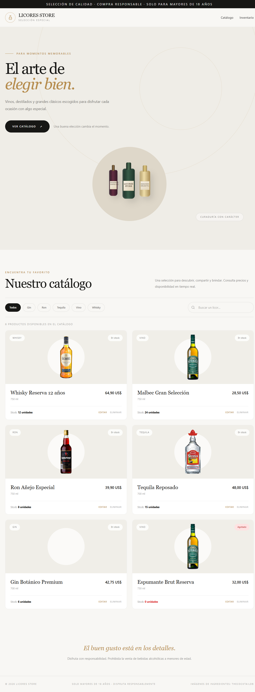
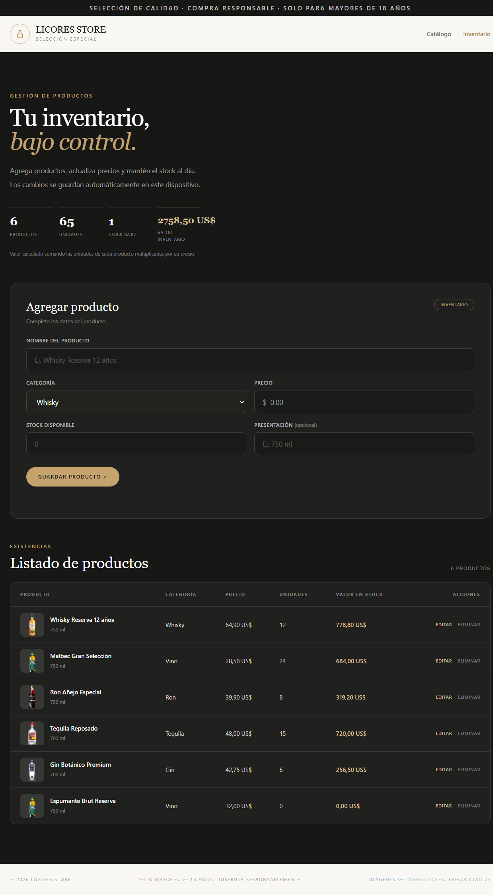

# Licores Store

Catálogo web responsive para una tienda de licores. Permite buscar y filtrar productos, administrar existencias y consultar el valor del inventario.

## Tecnologías

- HTML5
- Tailwind CSS mediante CDN
- JavaScript (sin frameworks ni dependencias locales)
- `localStorage` para guardar el catálogo en el navegador
- Open Food Facts para buscar imágenes de productos
- TheCocktailDB como fuente de imágenes genéricas de respaldo

## Ejecutar el proyecto

No hace falta instalar paquetes:

1. Descarga o clona el repositorio.
2. Abre `index.html` en un navegador moderno.
3. Para que carguen Tailwind CSS y las imágenes remotas, utiliza una conexión a Internet.

También se puede servir la carpeta con Python:

```powershell
python -m http.server 8000
```

Después, abre <http://localhost:8000>.

Los productos se guardan en el almacenamiento local del navegador actual; no se sincronizan entre dispositivos.

## Capturas de pantalla

### Catálogo



### Inventario



## Prompts del proyecto

Las siguientes solicitudes resumen los prompts utilizados para construir esta tienda:

1. **Diseño del sitio:** crear una tienda de licores en HTML con Tailwind CSS, apariencia moderna y paleta blanca, negra y dorada.  
   **Para qué:** definir la estructura visual, el estilo y la identidad de la página.
2. **Catálogo e inventario:** incluir productos con precio y stock, además de un formulario para administrar el catálogo y guardar los cambios en el navegador.  
   **Para qué:** implementar las operaciones de crear, leer, actualizar y eliminar productos.
3. **Imágenes y valoración de existencias:** utilizar imágenes de TheCocktailDB y calcular el valor del inventario a partir de unidades por precio.  
   **Para qué:** enriquecer las tarjetas y resumir el valor de las botellas disponibles.
4. **Vista independiente de inventario y búsqueda de imágenes:** agregar una opción de inventario con una fila por producto; buscar imágenes alcohólicas de marca en Open Food Facts y usar TheCocktailDB como respaldo con tolerancia a errores tipográficos.  
   **Para qué:** separar el catálogo del control de stock y mejorar la identificación de imágenes.

## Estructura

```text
.
├── app.js
├── index.html
├── README.md
└── screenshots/
    ├── catalogo.png
    └── inventario.png
```

## Uso de datos e imágenes

Open Food Facts se consulta al agregar o actualizar productos. Solo se aceptan resultados con categorías de bebidas alcohólicas y con una URL de imagen válida. Si la búsqueda falla o excede el límite de tiempo, la aplicación recurre a imágenes genéricas de TheCocktailDB. El pie de página enlaza a TheCocktailDB como atribución.
